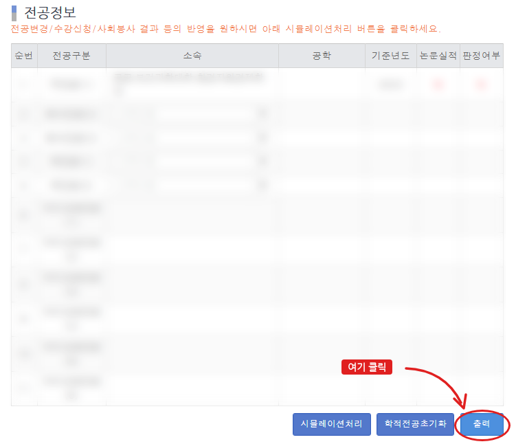
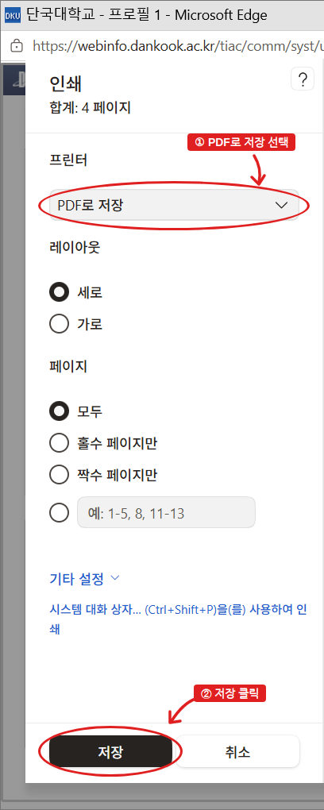

# 수강·졸업 도우미

식품자원경제학과(23학번까지 환경자원경제학과) 학생이 **자기 상황에 맞춰 졸업 요건을 확인하고, 남은 학기 수강 계획을 세우는** 웹 도구입니다.

### 👉 바로 사용하기: https://minser0228.github.io/grad-helper/

> **필독** 본 도구는 참고용입니다. 최종 졸업 판정은 학과사무실(041-550-3619)에 문의하세요.

---

## 이런 분께 필요해요

- 졸업까지 **몇 학점이 남았는지**, **어떤 과목을 꼭 들어야 하는지** 알고 싶은 분
- 트랙을 하고 있어서 **타과 과목이 전공으로 인정될지** 미리 알고 싶은 분
  (포털은 트랙 이수가 확정되는 막학기에야 타과 과목을 전공으로 반영합니다)
- 남은 학기에 **무엇을 언제 들을지** 계획을 세우고 싶은 분

## 쓸 수 있는 경우

| 쓸 수 있어요 | 아직 지원하지 않아요 |
|---|---|
| 14학번 이후 입학한 **재학생·편입생** | 13학번 이전 입학 |
| **심화전공**(전공 63학점) | 복수전공·부전공 (추후 추가 예정) |
| 트랙 안 함, 또는 트랙 **1~3개** | 교직, 조기졸업 |

판정 기준은 **2026학년도 학사종합안내**와 학과 교육과정·학과 공지를 따릅니다.

## 준비물

- 포털 **「자가진단 시뮬레이션」 PDF** 1개 (꼭 필요해요. 직접 입력하는 방법은 없어요)
- **PC 권장**: 휴대폰에서도 열리지만, PDF 저장은 PC가 훨씬 쉬워요

### 자가진단 시뮬레이션 PDF 가져오는 방법

1. 포털 → **웹정보 → 학사정보 → 졸업관리 → 자가진단 시뮬레이션**
2. 「전공정보」 아래 **「출력」** 버튼을 누릅니다.

   

3. 새 창이 뜨면 **인쇄**를 누르고, 프린터를 **「PDF로 저장」**으로 바꾼 뒤 **저장**합니다.

   

## 사용 순서

1. **PDF 넣기**: 사이트 첫 화면에 저장한 PDF를 끌어다 놓거나 눌러서 고릅니다.
2. **목적 고르기**: 「수강 계획 세우기」 또는 「졸업 요건 확인」을 고릅니다.
   위쪽 목적 버튼(▾)으로 언제든 바꿀 수 있고, 바꿔도 입력한 내용은 그대로예요.
3. **기본 정보 확인**: 학생 구분, 입학년도, 학년·학기가 PDF에서 자동으로 채워집니다. 틀린 곳만 「고치기」로 고치세요.
4. **과목·트랙**: 「트랙 안 함」 또는 「트랙 이수」를 고르고, 트랙을 고릅니다(최대 3개).
   과목을 누르면 **미이수 → 이수 → 수강 중** 순서로 바뀌어요. PDF에 없는 과목은 「과목 추가」로 넣습니다.
5. **결과 보기**: 고른 목적에 따라 「졸업 현황」 또는 「수강 계획」이 나옵니다.

## 결과 화면 읽는 법

### 졸업 현황

이번 학기 **수강 중인 과목까지 이수한다고 보고** 계산합니다.

- **졸업까지 남은 학점**: 전공·학과기초·교양·자유선택별로 나눠서 보여 줍니다.
- **꼭 들어야 할 과목**: 아직 안 들은 필수 과목입니다.
- **트랙**: 트랙마다 남은 기준(모듈과 학점)을 보여 줍니다.
- **노란 경고**: 수강 중인 과목을 놓치면 부족해지는 기준이 있다는 뜻이에요.
- **학점 외 졸업 요건**(졸업시험·공인외국어·사회봉사): 포털 자가진단 시뮬레이션에서 P(통과)인지 확인하고 「충족」에 체크하세요.
  공인외국어 성적은 **포털에 직접 등록해야** 인정됩니다.

### 수강 계획

- **앞으로 들어야 할 학점**, **꼭 들어야 할 과목**, **트랙 기준 채우기**를 먼저 보여 줍니다.
- 「추천 시간표 만들기」를 누르면 **가장 적은 학점으로 졸업하는 안**이 나와요. 「다른 버전 만들기」로 다음 안을 볼 수 있어요.
- 과목 아래 **「바꿔도 됩니다」** 표시가 있으면, 그 과목 대신 다른 과목을 들어도 졸업·트랙 기준이 그대로 채워진다는 뜻이에요.
- 과목은 끌어다 놓거나 메뉴로 다른 학기로 옮길 수 있어요.
- 개설 학기는 학과 교육과정의 **표준 개설 학기 기준 추정**입니다. 실제 개설 여부는 수강신청 시간표에서 꼭 확인하세요.

## 내 정보는 안전한가요?

- PDF는 **내 브라우저 안에서만** 읽고, 서버나 다른 곳으로 **보내지 않습니다.** (이 도구에는 서버가 없어요)
- **창(탭)을 닫으면** 입력한 내용이 모두 지워집니다. 공용 PC에서도 그냥 닫으면 됩니다. 새로고침은 괜찮아요.
- 다음에 이어서 쓰려면 「기본 정보」 아래 **「백업 파일 저장」**을 누르세요. 이름·학번은 들어가지 않아요. 다음에 **「백업 불러오기」**로 이어서 씁니다.

## 자주 묻는 질문

**Q. 포털 자가진단과 숫자가 달라요.**
트랙을 고르면 **트랙을 마친다고 가정하고** 타과 과목을 미리 전공으로 계산해요. 그래서 포털보다 전공 학점이 많게 보일 수 있습니다. 수강 중인 과목도 이수한 것으로 계산해요.

**Q. F나 NP를 받은 과목은 어떻게 되나요?**
학점이 인정되지 않는 과목으로 빼고 계산합니다. 필수 과목이면 수강 계획에 재수강으로 다시 들어가요. 나중에 통과하면 마지막 기록을 씁니다.

**Q. 편입생도 쓸 수 있나요?**
네. 전적대 인정 학점을 PDF에서 읽어 옵니다. 틀렸을 때만 「직접 고치기」로 고치세요.

**Q. 이 도구에서 트랙을 신청하나요?**
아니요. 트랙 이수 신청은 학기마다 신청 기간이 있어요. 학과 홈페이지와 과톡방 공지를 확인하세요.

**Q. 화면이 비어 있거나 안 바뀌어요.**
**Ctrl+Shift+R**(휴대폰은 당겨서 새로고침)로 새로고침해 주세요.

**Q. 처음부터 다시 하고 싶어요.**
오른쪽 위 **「새로 시작」**을 누르면 입력이 모두 지워지고 처음 화면으로 돌아갑니다.

## 판정 기준 요약

| 항목 | 기준 |
|---|---|
| 졸업 학점 | 130학점 |
| 전공 (심화) | 63학점 |
| 학과(부)기초 | 12학점 |
| 교양 | 학번·학적마다 다름 (예: 23학번 34, 24학번 30, 25학번 이후 28, 편입생 28) |
| 전공필수 | 14~19학번 6과목 / 20~23학번 5과목 / 24학번부터는 전공필수 대신 **모듈 내 필수 6과목** |
| 트랙 (선택) | 학과전공트랙: 정해진 모듈 5개에서 모듈마다 6학점 / 푸드바이오경제: 학과 모듈 15학점 + 바이오헬스 8학점 + 식품영양·식품공학 7학점 |
| 학기당 수강 | 기본 최대 19학점 (성적초과·이월 등 추가 학점은 따로 반영) |
| 졸업시험 | 합격, 또는 면제 조건(TOEIC 800 등) 충족 |
| 공인외국어 | TOEIC 600 이상 등 |
| 사회봉사 | 32시간 (온라인특강 1강좌 이상 포함) |

「졸업 현황」 화면 맨 아래 **「판정 기준 출처」**를 펼치면 학사종합안내 쪽 번호와 함께 근거를 볼 수 있어요.

## 오류 제보·문의

- 결과가 이상하면 [GitHub Issues](https://github.com/minser0228/grad-helper/issues)에 남겨 주세요. **성적표, 이름, 학번은 올리지 마세요.**
- 졸업 판정에 관한 공식 문의는 학과사무실(041-550-3619)로 하세요.

---

개발자용 안내(실행·테스트·기준 갱신·판정 규칙 상세)는 [docs/개발자-안내.md](docs/개발자-안내.md)에 있습니다.
